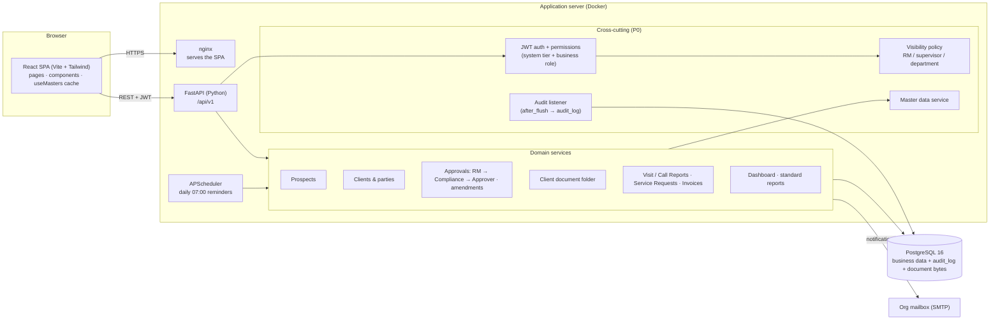

# Triam CRM — Architecture

Status: updated for the BRD alignment (20 Oct 2026). Answers BRD §21 "Architecture diagram — to be prepared".

## Components

## Request lifecycle
1. The browser calls `/api/v1/...` with a JWT.
2. `get_current_user` resolves the user, then stamps the user and IP on the request's DB session (`set_actor`).
3. Permission checks run (`require_roles` for the system tier, `require_permission` for BRD §13 flags).
4. The service applies the visibility policy (`access_control`) to every client query; prospects, service requests, invoices and reports follow the client.
5. On commit, the audit listener writes one `audit_log` row per created, updated or deleted audited record, with field-level before/after values.

## Access model (BRD §13)
| Layer | What it controls |
|---|---|
| System tier `users.role` (Administrator / staff user) | Administrators see and manage everything |
| Business roles `roles` (CO, MLRO, Dy MLRO, RO, FO, Sales Manager, Approver, Accountant, Inquiry, Prospecting Coordinator, …) | Permission flags such as `client.approve`, `client.final_approve`, `client.cdd_edit`, `invoice.manage`, `prospect.assign`, `read_only`, `view.all_clients`. One user may hold several roles. |
| Supervisor chain `users.supervisor_id` | A supervisor sees everything their direct and indirect reports see |
| Client assignment (Anchor RM, Non-anchor RMs, creator) | Which clients an RM sees |

## Hosting (BRD §21)
Initial: six months on the vendor server with daily DB backups (weekend backups retained). Later: AWS/Azure, subject to approval. SharePoint hosting is under review.
