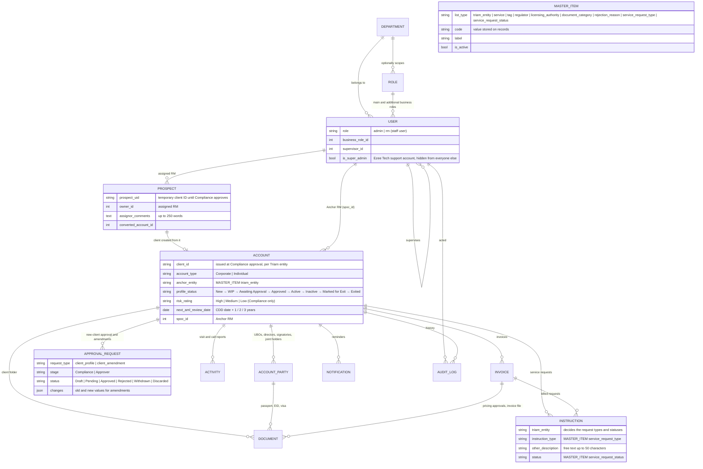

# Triam CRM — Data Model

Status: updated for the BRD alignment (20 Oct 2026). Answers BRD §21 "Data relationships / ER diagram — to be prepared". Everything hangs off the **client** (`ACCOUNT`); there is no separate case record.

Master values are stored by **code** and referenced by convention (no foreign key), so deactivating an item never breaks old records. Validation of new values happens in the service layer. Records are never deleted: they are cancelled, removed or deactivated with a reason and stay in the database.
